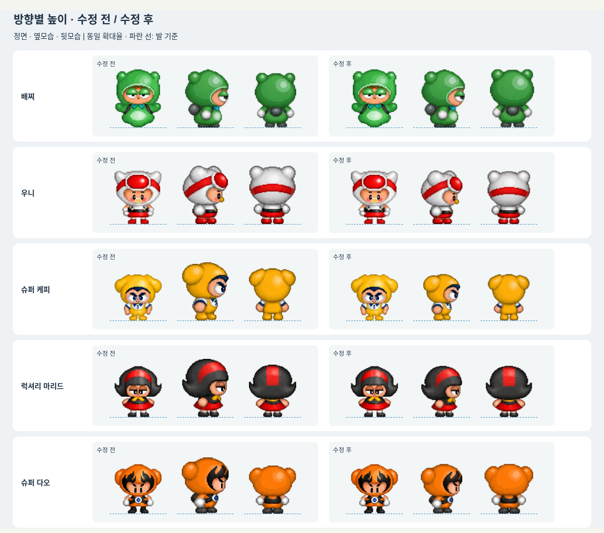
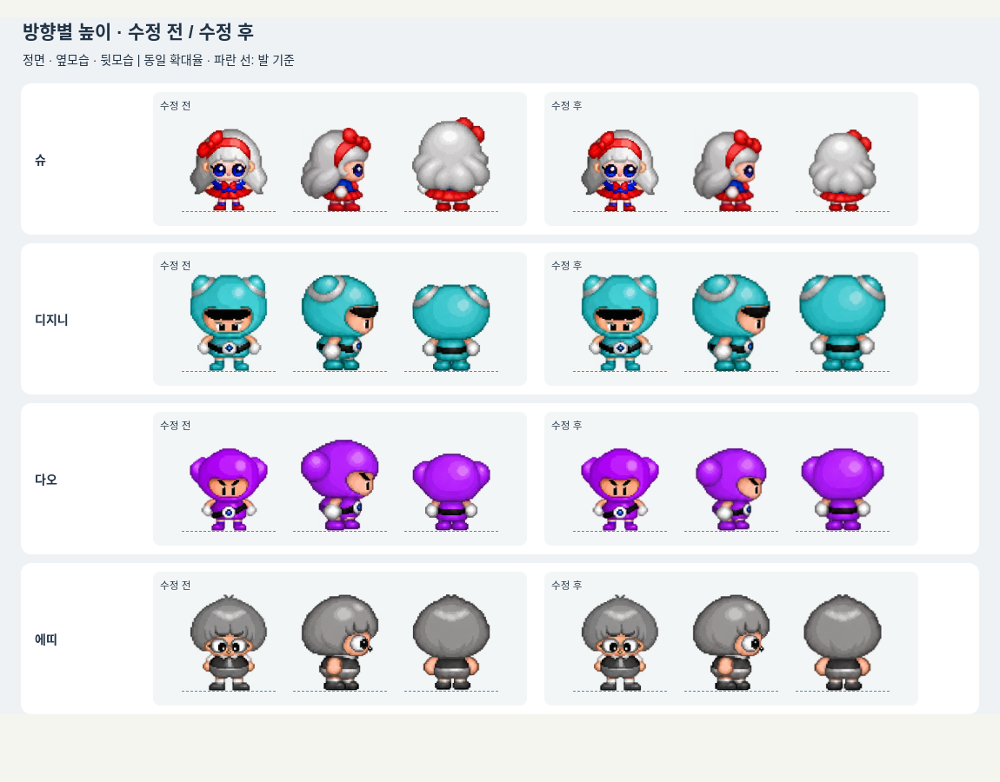
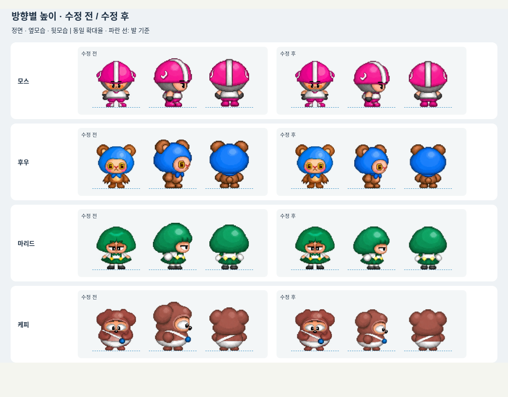

# 방향별 캐릭터 높이 보정 미리보기

사용자가 13종 수정 전후 비교와 좌우 보정을 확인한 뒤 나머지 적용 단계 진행을 승인했다. 이 보정을 게임에 적용하고 Windows ZIP을 갱신한다.

각 캐릭터의 정면 정지 프레임을 기준으로 옆/뒤의 머리 꼭대기~발바닥 실루엣 높이를 맞춘다. 장식이 있는 캐릭터는 같은 장식을 포함한 실루엣을 기준으로 시각 비교했다. 인체 관절을 자동 판독한 측정은 아니다.

동일한 방향의 네 프레임에는 하나의 균일 배율과 발 위치 오프셋만 적용한다. 걷기 프레임의 변화를 개별 정규화하지 않는다. 원본 PNG/몸 비율/이동·충돌 규칙은 유지한다. 표시 여백은 가로64→72로 늘리고 표시 폭도72/64로 보상해 정면 크기를 유지하며 확대된 뒷모습의 잘림을 방지한다. 갇힘/엎드림은 보정 대상에서 제외한다.

원본 텍스처 알파>80, 정지 프레임의 측정값(물리 캔버스 픽셀):

| 캐릭터 | 수정 전 정면/옆/뒤 높이 | 수정 후 정면/옆/뒤 높이 |
|---|---|---|
| 배찌 | 148 / 148 / 139 | 148 / 148 / 148 |
| 우니 | 136 / 148 / 148 | 136 / 136 / 136 |
| 슈퍼 케피 | 118 / 148 / 133 | 118 / 118 / 118 |
| 럭셔리 마리드 | 130 / 148 / 133 | 130 / 130 / 130 |
| 슈퍼 다오 | 126 / 143 / 122 | 126 / 126 / 126 |
| 슈 | 125 / 128 / 144 | 125 / 125 / 125 |
| 디지니 | 148 / 146 / 133 | 148 / 149 / 148 |
| 다오 | 127 / 140 / 119 | 127 / 127 / 127 |
| 에띠 | 148 / 148 / 147 | 148 / 148 / 148 |
| 모스 | 140 / 148 / 145 | 140 / 140 / 140 |
| 후우 | 133 / 148 / 144 | 133 / 133 / 133 |
| 마리드 | 130 / 141 / 136 | 130 / 130 / 130 |
| 케피 | 125 / 148 / 131 | 125 / 125 / 125 |

정지 프레임 발바닥은 모두 y=156(끝 경계)으로 정렬했다. 156개 캔버스(13종×3방향×4프레임)에서 가장자리 잘림이 없는 것을 확인했다. 좌측은 수정 전/우측은 수정 후이며 각 묶음은 정면·옆·뒤 순서다.

