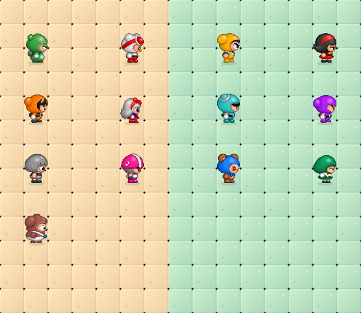
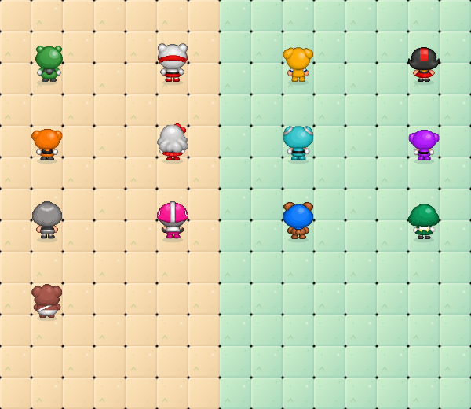

# 13종 방향별 걷기와 갇힘·사망

검증: 타입 검사·제품 빌드·규칙/소켓 129개·전체 Chromium 브라우저 37개 통과. 13종 실제 렌더링과 발 픽셀 변화, 정지 방향 유지, 공유 상태 불변 및 기존 사망/부활·연습/온라인 흐름을 확인했다. 최종 Windows ZIP은 53,681,332바이트이며 CRC·SHA-256이 일치한다. 이번 커밋의 Windows 네이티브 실행 결과는 별도 확인이 필요하다.

13종 모두 좌우·뒤 4프레임과 정면 발 동작을 사용한다. 현재 정면을 바탕으로 옆·뒤를 먼저 제작하고, 사용자가 사진을 구하면 해당 그림을 교체하기로 합의했다. 원작의 미확인 뒷모습은 추정 디자인이며 유튜브는 여전히 미확인이다.

사용자가 첨부한 배찌 옆·뒷모습, 슈 좌우 참고, 파란 갇힘 물풍선과 엎드린 사망 사진을 바탕으로 이미지 도구로 투명 4×4 시트를 재구성했다. 원본 픽셀 추출본은 아니며, 원작과 완전 동일하다고 보장하지 않는다. 유튜브는 여전히 미확인이다.

- 배찌 ID 0: 초록색 유지. 우측 옆모습 4프레임과 좌측 반전, 뒷모습 4프레임. 얼굴은 방향에 따라 실제 옆·뒤 실루엣으로 전환한다.
- 슈 ID 5: 승인된 기존 좌우 옆모습을 유지하고 은빛 머리·빨간 리본이 보이는 뒷모습 걷기를 새로 추가했다.
- 나머지 11종: 정면의 모자/머리/의상/색상/체형을 바탕으로 실제 옆·뒤 실루엣과 발/팔 동작을 추정 제작했다. 오른쪽 그림을 좌우 반전해 왼쪽으로 사용한다. 비대칭 소품도 반전되므로 실제 자료가 생기면 좌우 그림을 독립 제작할 수 있다.
- 정면은 13종 모두 기존 그림을 유지하며 발 부분을 별도로 움직인다. 옆·뒤는 4프레임(기본/왼발/기본/오른발)이며 각 동작의 공통 알파 경계를 사용해 크기와 발 기준점을 고정한다. 정지 시 마지막 방향의 0번 프레임으로 멈춘다.
- 갇힌 캐릭터는 첨부처럼 작은 회색 인물이 보이는 공통 파란 구형 물풍선 이미지를 사용한다. 후반으로 갈수록 흰 거품 이미지가 혼합되고 호흡/흔들림과 상승 기포가 빨라진다. 갇힘 시간 5초와 기본 속도 40%, 바늘 탈출 판정은 유지한다.
- 사망 후 처음 600ms는 흰 물풍선, 이후 물방울 파열과 엎드림, 마지막 700ms 페이드 후 기존 엔진에서 부활한다. 13종 모두 characters-prone.png의 전용 엎드린 그림을 유지한다.
- 모든 단계는 표시만 바꾼다. 공유 상태, 점수, 아이템 드롭·비행, 사망/재생성 판정은 변경하지 않는다. 온라인과 연습은 같은 렌더러를 사용한다. 흰 거품 표시 객체는 탈출/부활 때 숨기고 플레이어 제거/종료/초기화 때 제거한다.

## 시트와 추후 교체

character-sheets.ts가 다음 4열×6행 시트를 연결한다. 캐릭터마다 2개 행을 쓰며 짝수 인덱스 행은 오른쪽, 다음 행은 뒤다. 한 행의 4열은 4개 걷기 프레임이다.

| 시트 | 위부터 캐릭터 ID |
| --- | --- |
| characters-walk-a.png | 1 우니, 2 슈퍼 케피, 3 럭셔리 마리드 |
| characters-walk-b.png | 4 슈퍼 다오, 6 디지니, 7 다오 |
| characters-walk-c.png | 8 에띠, 9 모스, 10 후우 |
| characters-walk-d.png | 11 마리드, 12 케피, 5 슈(뒷모습만 사용) |

배찌와 슈의 기존 좌우 그림은 character-motion.png에서 유지한다. 참고 사진을 확보하면 해당 캐릭터 행을 이미지 도구로 교체하거나 전용 시트를 추가하고 매핑을 조정한다. 걷기 재생/정지/온라인 판정을 다시 구현할 필요는 없다.

검사 화면: test-results/all-characters-{right,left,up,down}.png와 기존 trap-blue.png, trap-white.png, prone-death.png. 개발 fixture는 제품과 동일한 GameRenderer를 사용한다. 새 검사는 13종의 4방향 표시·정지 방향·실제 발 부분 픽셀 변화·렌더 중 공유 상태 불변을 확인한다.

실제 렌더러로 표시한 캐릭터 검사 화면:

