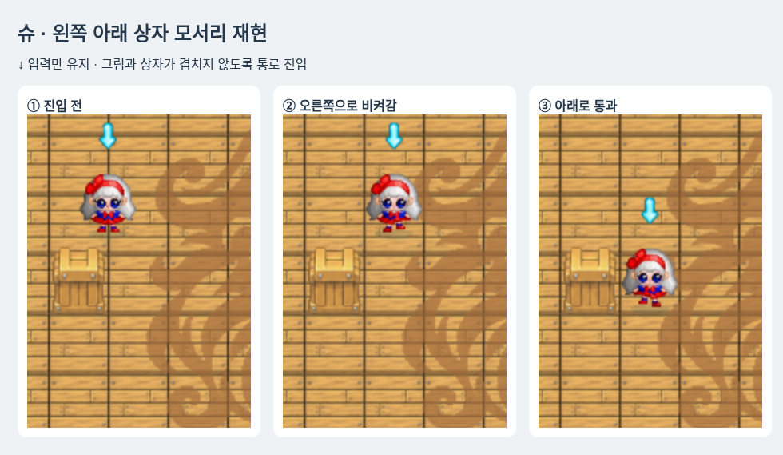

# 사진의 왼쪽 아래 모서리 재현

이전 얕은 겹침 보정(3deb8c0)은 사용자의 실제 상황을 해결하지 못했다. 이번에는 캐릭터가 타일 경계를 걸친 경우 인접 통로까지 찾아 필요한 옆 이동을 마친 후 원래 방향으로 전진한다. 각 틱의 실제 이동은 한 축만 수행한다.

테마 맵의 장애물 충돌 폭은39.2px, 물줄기 피격 폭은22.4px로 별개다. 물풍선의 탈출 예외도 장애물 충돌 몸체가 완전히 빠져나갈 때까지 유지한다. 캐릭터는 전체 방향/프레임 중 가장 넓은 그림에 맞춰 모든 방향에 공통 배율을 적용하고 좌우 최소0.6px 여유를 둔다. 방향별 높이 관계와 원본 비율을 유지한다.

온라인 보간이 모서리를 가로지르는 위치를 만들면 통과 가능한 실제 위치를 표시한다.

## 검증

슈와 왼쪽 아래 상자 배치를 제어된 렌더러 fixture로 재현했다. x=3.98/4.02/4.13, y=4.51에서 ↓만 유지했다. 매 프레임 충돌 몸체의 통과 여부와 화면의 실제 캐릭터 그림 경계(알파>32)가 상자 그림의 사각형 경계(40×48px)와 겹치지 않는지 검사했다. 이 결과는 해당 재현 배치에 대한 것이며 모든 시점의 머리/장식과 모든 맵 오브젝트의 픽셀 겹침을 전수 검증한 결과는 아니다.

규칙151개와 최종 Chromium6개가 통과했다. 네 방향, 반대쪽 모서리, 벽/상자/물풍선, 일반/갇힘 속도, 정면 벽 및 막힌 옆 경로도 규칙 검사에 포함한다. Windows 실기기 실행은 미검증이다.

[제어된 재현 영상](previews/corner-clearance/motion.webm)
