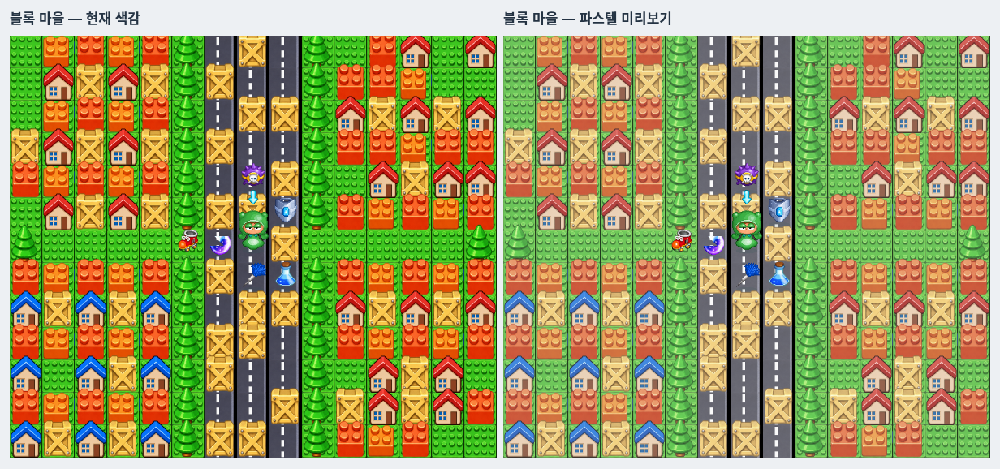
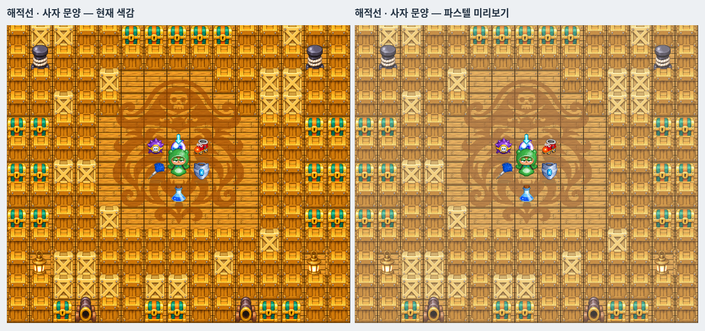
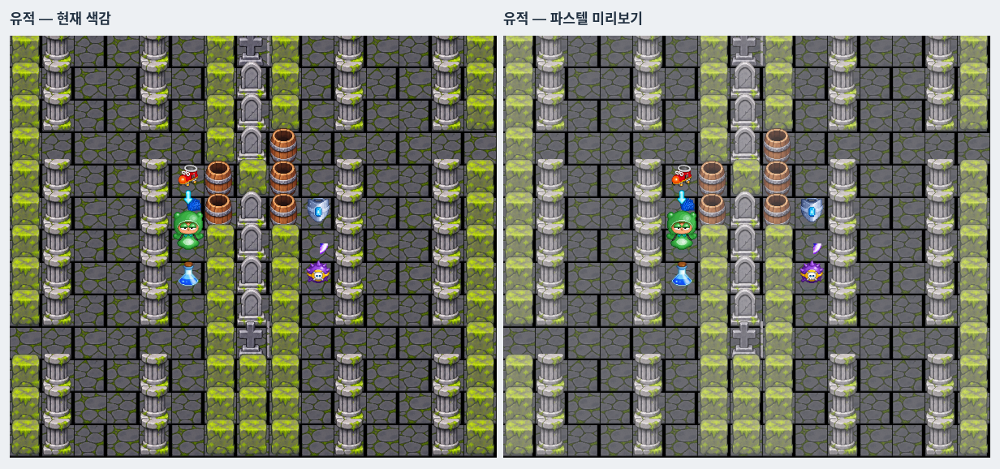

# 승인된 파스텔 맵 색감

사용자가 7종 비교 화면의 오른쪽 색감을 승인해 전체 경기의 기본값으로 적용했다. MapPalette의 기본값은 pastel이며 비교용 original 옵션도 남겨 두었다.

타입 검사·제품 빌드·Vitest 138개·전체 Chromium 40개와 7종 색감/전경 픽셀 지문 비교를 통과했다. 최종 Windows ZIP CRC·SHA-256도 확인했다. 이번 커밋의 Windows 네이티브 실행 결과는 별도 확인이 필요하다.

- 대상: 바닥, 벽, 부술 수 있는 상자·집, 나무, 돛대·문양 등 맵 장식.
- 보존: 캐릭터, 물풍선, 아이템, 폭발 물줄기, 자기 캐릭터 화살표, UI와 효과.
- 처리: 맵 텍스처 생성 시 채도를 78%로 줄인 뒤 흰색을 17% 혼합한다. 투명도는 유지하며 원본 PNG는 변경하지 않는다. 프레임마다 처리하거나 화면 전체에 필터를 씌우지 않는다.
- art.ts에서 art-arena-*, art-ground-*, art-wall*, art-crate*에만 적용한다. GameRenderer는 같은 옵션을 사용하므로 연습과 온라인에서 같다.

7종 실제 렌더러 비교를 재생성하고 캐릭터·물풍선·바늘·물줄기 아이템·폭발 물줄기·화살표 텍스처의 픽셀 지문이 원본과 일치함을 확인했다. 같은 상태/정지된 애니메이션으로 비교해 색감 차이만 볼 수 있다. 아래에서 왼쪽은 원본, 오른쪽은 승인된 기본 색감이다.

그 외: [중앙 돛대](previews/pastel/pirate-mast.png), [광산](previews/pastel/gem-mine.png), [공장](previews/pastel/container-factory.png), [숲](previews/pastel/moss-forest.png).
