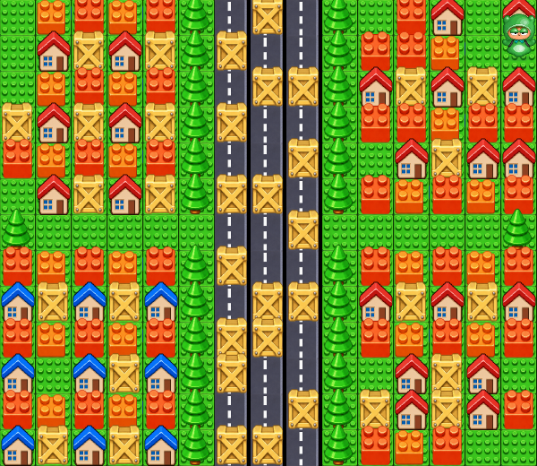

# 랜덤 테마 맵

최신 중앙 돛대: pirate-mast의 m 장애물은 아래 받침3칸(0기준6,6 / 7,6 / 8,6)만 남긴다. 기존 뒤쪽5칸(7,3 / 7,4 / 6,5 / 7,5 / 8,5)은 바닥으로 바꿔 통행 가능하게 한다. 돛대 그림200×200px과 밑면 기준 depth276은 유지해 뒤로 들어간 캐릭터를 가린다. 다른 맵/주변 상자는 유지한다.

최신 변경: 인게임 바닥/비행 아이템을 직전 크기의95%로 축소(42.4186875×44.77528125px)한다. 쉴드 기준 긴 변 정규화는 유지한다. 시작 위치는 빈 바닥만으로 출발 칸 포함3~5칸 경로 안에서 기본 물풍선의 십자 범위를 벗어날 수 있는 칸만 추첨한다. 2칸 포켓·3칸 일자 중앙은 제외하고 기존 맵/상자는 유지한다. 연습·온라인·재시작/재대결에 공통 적용된다.

현재 7종 맵은 사용자가 승인한 파스텔 색감을 기본으로 사용한다. 바닥·벽·상자·집·나무·장식만 연하게 처리하고 캐릭터·물풍선·아이템·물줄기는 기존 색상을 유지한다. 맵 배치/충돌/드롭 규칙은 같다. [승인된 비교 화면](map-palette.md)을 따른다. 아래 원본 색감 이미지는 이전 기록이다.

최신 마을 수정: 사용자가 보라색으로 표시한 가로 통로 나무 두 칸(0기준 x=4/10, y=6)을 바닥으로 바꾸고 충돌도 제거했다. 같은 행의 양 끝 나무와 도로변 가로수는 유지한다. 빨강·파랑 집 지붕의 세 볼록 장식은 village-houses.png로 제거했으며 집의 위치와 벽 판정은 같다. art.ts에서 theme=2, column=4/6에만 적용해 다른 맵/블록 외형을 보존한다. 타입 검사·제품 빌드·Vitest 134개·맵 브라우저 9개 및 ZIP CRC·SHA-256을 확인했다. 아래는 이전 맵 안내다.

연습과 온라인에서 시작·초기화·재대결마다 사진 기반 7종 중 하나를 추첨한다. 직전에 사용한 맵은 다음 추첨에서 제외한다. 재접속과 사망 후 재생성은 같은 맵을 유지한다. 중복된 광산 사진은 하나로 묶었다. 원본 픽셀/모든 장식 위치를 추출한 동일본이 아니라 배치와 테마를 타일로 재현한 버전이다.

| ID                | 표시 이름          | 참고 사진   | 그림 행 |
| ----------------- | ------------------ | ----------- | ------- |
| pirate-lion       | 해적선 · 사자 문양 | 1           | 0       |
| pirate-mast       | 해적선 · 중앙 돛대 | 2           | 1       |
| toy-village       | 블록 마을          | 3           | 2       |
| gem-mine          | 보석 광산          | 4, 7 (중복) | 3       |
| container-factory | 컨테이너 공장      | 5           | 4       |
| moss-forest       | 이끼 숲            | 6           | 5       |
| ancient-ruins     | 고대 유적          | 8           | 6       |

## 시작과 판정

모두 15×13 타일이다. 빈 칸 중 적어도 한 방향으로 이동할 수 있고, 블록을 부수면 이어질 수 있는 같은 영역에서 시작 위치를 추첨한다. 머리가 화면 밖으로 잘리지 않도록 최상단 행은 시작 후보에서 제외한다. 위치를 중복시키지 않고 가능하면 최소 4칸 떨어뜨린다. 카운트다운 중 맵·위치·판정은 정지한다.

새 맵은 공유 경기장으로 RED/GREEN의 인위적인 좌우 절반 제한이 없다. 몬스터의 기존 소속·점수·추격 규칙은 유지하며 실제 바닥과 플레이어 안전 거리를 따라 생성·이동한다. 사망 아이템도 접근 가능한 바닥에 떨어뜨린다. 사망 후에는 같은 맵에서 원래 무작위 시작 지점 근처의 안전한 빈 칸으로 재생성된다. 과거 고정 정원/일반 연습 생성 함수는 내부 규칙 fixture에 보존했다.

## 다음 맵 추가

`packages/shared/src/maps.ts`의 `ARENAS`에 고유 `id`, `name`, `theme`, 13개의 `rows` 문자열을 추가한다. 각 행은 정확히 15글자다. 같은 테마의 다른 배치는 이 데이터만 추가하면 두 모드의 추첨 목록에 들어간다. 완전히 새로운 테마는 그림 시트와 `art.ts`의 텍스처 등록 범위도 함께 확장한다. 일부 통로는 실제 플레이를 위해 빈 칸을 확보했고, 마을의 통로 나무 일부는 파괴 가능하게 했다.

| 글자     | 판정      | 표시                        |
| -------- | --------- | --------------------------- |
| `.`      | 빈 바닥   | 기본 바닥                   |
| `r`      | 빈 바닥   | 도로/위험 표시 등 보조 바닥 |
| `b`      | 파괴 가능 | 기본 블록                   |
| `c`      | 파괴 가능 | X 상자/광산 광석            |
| `t`      | 파괴 가능 | 상자/추가 블록              |
| `v`      | 파괴 가능 | 마을 통로 나무              |
| `w`      | 고정 벽   | 기둥/나무/돌                |
| `h`      | 고정 벽   | 대포/집/갱도/실린더/묘비    |
| `d`      | 고정 벽   | 등불/집/바위/콘/돌/십자가   |
| `m`, `p` | 고정 벽   | 큰 돛대/연못의 충돌 영역    |

`decorations`는 큰 문양·돛대·연못 그림의 범위를 정의한다. 큰 구조물을 추가하면 해당 영역의 `m`/`p` 충돌도 함께 맞춘다. 바닥은 모든 블록 아래에 그려져 파괴 후 정상적으로 드러난다. 그림은 이미지 생성 도구로 만든 `arena-tiles.png`(8×8 시트의 앞 7행)와 `arena-landmarks.png`(2칸)를 사용한다. 레퍼런스의 테마를 참고한 새 리소스이며 스크린샷을 바닥에 통째로 붙인 방식은 아니다.

## 확인 범위

`maps.test.ts`는 모든 레이아웃의 크기·타일·시드 결정성·목록 전체 추첨·연속 반복 방지·다양한 시드의 시작 위치/거리·몬스터 이동·사망 후 재생성을 검사한다. `maps.spec.ts`는 7종을 실제 렌더러로 캡처하고 연습 초기화와 온라인 맵/좌표 일치를 확인한다. 키보드/포터블 검사는 현재 맵의 빈 칸 방향으로 이동한다. 원작의 모든 충돌 속성/배치와 동일한지에 대한 실측 검증은 아니다.

타입 검사·제품 빌드·Vitest 121개 통과. Chromium 전체 32개 중 31개 통과 후, 온라인 검사의 짧은 카운트다운을 두 화면에서 동시에 관찰하도록 고쳐 해당 항목도 통과했다. 키를 놓은 뒤 온라인 보정이 0.005칸 미만으로 수렴하는 것은 허용하면서 계속 이동하는 오류는 검출한다. 최종 화면 배치에서 경기장과 하단 버튼이 겹치지 않음을 확인했다.

Node/PATH 없는 한글 폴더의 Linux 포터블 파일에서 연습·초기화·카운트다운·두 브라우저 온라인 대전·방향키/Space/Ctrl을 검증했다. 클라우드의 사설 IP 브라우저 제한 때문에 루프백 주소를 사용했으며 실제 Windows/LAN 실측으로 표시하지 않는다. Windows ZIP은 EXE·그림·한글 안내를 포함하고 압축 CRC·SHA-256을 확인했다.
