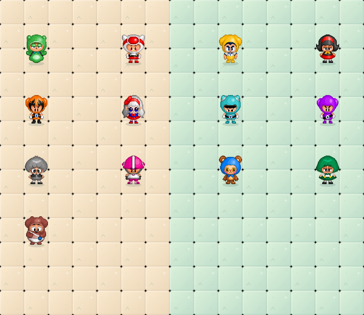
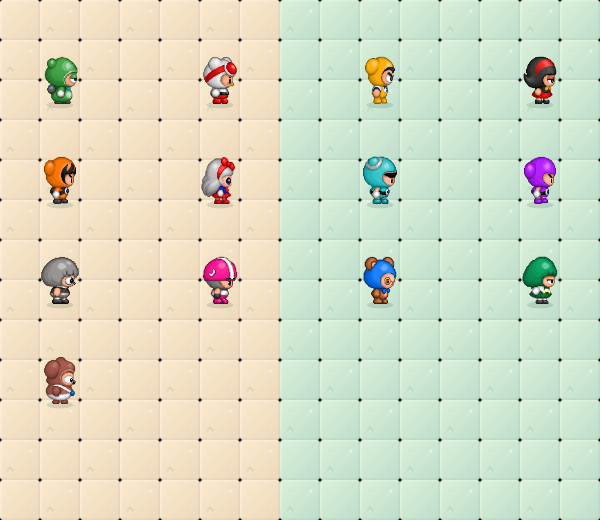
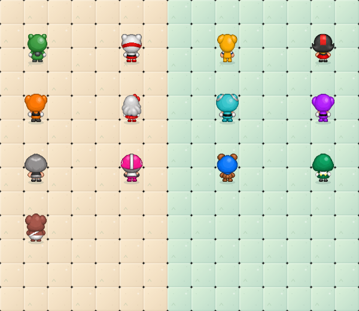

# 우니 기준 공통 크기

사용자가 우니 +10%를 기준으로13종 높이 통일과 설치형 물풍선 -5% 변경안을 승인했다.

실제 서 있는 머리~발 높이는47.3733px를 목표로 한다. 방향별 텍스처의 보간/픽셀 차이를 포함한 허용 오차는0.6px다. 정상 캐릭터는 발 기준선을 worldY+4px에 맞춘다. 걷기의 발 변화는 보존한다.

원래 비율을 그대로 확대하면 일부 외형의 폭이 약48px까지 되어40px 통로를 넘는다. 적용 시 높이는 승인 기준대로 유지하고 가로 배율만 별도로 제한해 실제 그림 폭은 최대38px로 맞췄다. 따라서 일부 캐릭터는 비율 유지 미리보기보다 날씬하게 보인다. 충돌 폭39.2px 안에 좌우0.6px 여유를 확보한다. 원본 PNG는 바꾸지 않는다.

설치형 물풍선의 표시영역을 기존 대비0.95배로 한다. 본체는 기본 약33.35×35.15px이고 기존 맥동/부유는 유지한다. 갇힘/아이템 크기 및 이동/충돌 규칙은 유지한다.

규칙152개 및 브라우저4개 검사를 통과했다. 아래는 크기 변경이 적용된 실제 렌더러의 검사 화면이다.

